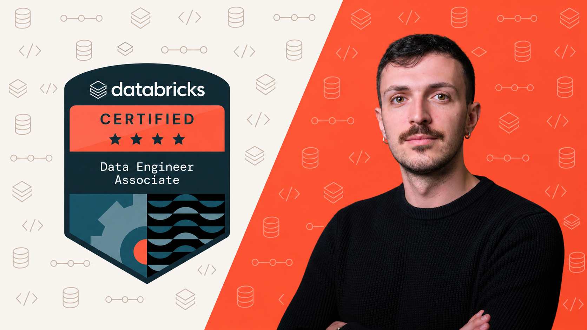

<div align="center">



# Databricks Data Engineer Associate: course code

**Hands-on notebooks, data generator, pipeline, job and bundle for the Associate certification**<br>
by [Fernando De Nitto](https://medium.com/@fernandodenitto)


</div>

This is the code for my Udemy course on the **Databricks Certified Data Engineer Associate**
exam, built against the guide updated on 6 August 2026 for the exam version of 4 May 2026. The
videos and quizzes are on Udemy; the link goes here when the course is live. You can use this repo
on its own too: the notebooks explain themselves, and the reference cards stand alone.

You build one lakehouse from end to end for **Lakeshore Outfitters**, a fictional outdoor-gear
shop: raw files → bronze → silver → gold → pipeline → job → bundle → dashboards and Genie →
governance → optimization.

## Zero cost, zero cloud setup

Everything runs on **[Databricks Free Edition](https://www.databricks.com/learn/free-edition)**:
no credit card, no Azure, AWS or GCP account.

Free Edition has real limits, and where it can't do something the course says so and teaches the
topic as labeled theory instead of faking a demo. That covers classic clusters, the Spark UI,
external locations and external tables, Lakeflow Connect managed connectors, and the account
console. The exam still asks about them, so the course covers them in full on slides.

## Start here

**1. Clone this repo as a Git folder**

1. In your workspace: **Workspace** → your home folder → **Create** → **Git folder**
2. Paste this repo's URL, provider **GitHub**. It's public, so no credentials are needed

Run every notebook from where it sits. Don't download single files or move them: several notebooks
walk up the tree to find `datagen/`.

**2. Run the setup notebook**

Open `sections/02-data-engineering-foundations/02-06-meet-lakeshore`. It creates what every later
lesson depends on:

```
lakeshore
├── landing    volume `files`, the landing zone
├── bronze     raw, exactly as ingested
├── silver     cleaned and validated
└── gold       business-level aggregates
```

**3. Follow the sections in order.** Each one builds on the objects the previous one left behind.
Every notebook runs on serverless compute: nothing to create, nothing to attach.

## What's in here

```
datagen/
├── datagen.py    the dataset: customers, addresses, products, orders, payments, refunds
└── feed.py       drops new files into the landing volume, for the streaming lessons
sections/
├── 05-data-ingestion/05-03-copy-into                a notebook, named after its lesson: 5.3
├── 05-data-ingestion/05-09-auto-loader-options.md   a reference card: syntax and options
├── 07-declarative-pipelines/pipeline/               the pipeline's source files
├── 08-lakeflow-jobs/job/lakeshore-daily.json        the job definition
└── 09-cicd/bundle/                                  a real, deployable bundle
resources.md      every official doc link the lessons use, by section
```

| Section | You build or learn | Main exam domain weight |
|---|---|---|
| 1 Welcome | Workspace setup, the exam, the method | |
| 2 Foundations | ETL to ELT, medallion, Delta, the dataset | |
| 3 Platform and compute | Workspace, notebooks, serverless, classic compute (theory) | 6% |
| 4 Delta Lake | Tables, time travel, OPTIMIZE, VACUUM, cloning | |
| 5 Ingestion | COPY INTO, Auto Loader, streaming, Lakeflow Connect, REST | 21% |
| 6 Transformation | Bronze to silver to gold, in SQL and PySpark | 22% |
| 7 Pipelines | Lakeflow pipelines (formerly Delta Live Tables), expectations | |
| 8 Lakeflow Jobs | Tasks, control flow, triggers, statuses, repair | 16% |
| 9 CI/CD | Git folders, Declarative Automation Bundles, the CLI | 10% |
| 10 SQL and BI | Warehouses, dashboards, alerts, Genie (beyond the exam) | |
| 11 Governance | Unity Catalog, grants, row filters, masks, ABAC, dynamic views | 15% |
| 12 Troubleshooting | Spark execution, skew, spill, query profile, liquid clustering | 10% |
| 13 Exam strategy | Traps, the official samples, a one-page recap | |
| 14 Next steps | The Professional gap map, study resources | |

**`datagen.py`** is standard library only, and deterministic by seed, so your numbers match the
videos: 1,080 orders, 2,602 order lines, revenue 854,427. Its `dirty=` flags inject controlled
data-quality problems for the cleaning lessons.

## Requirements

| | |
|---|---|
| **Workspace** | A [Free Edition](https://www.databricks.com/learn/free-edition) account |
| **Section 9 only** | The [Databricks CLI](https://docs.databricks.com/aws/en/dev-tools/cli/install) and a configured profile |

No `pip install`, no external services.

## If something goes wrong

- **Compute shut off for the day.** Free Edition has a daily quota, and heavy use can stop compute
  until the next day. See the [limits page](https://docs.databricks.com/aws/en/getting-started/free-edition-limitations).
  Lessons with pipelines and materialized views use the most, so don't run them all in one sitting.
- **`ModuleNotFoundError: datagen`.** The notebook isn't inside the Git folder. Clone the repo as
  above and run it from there.
- **A different number from the video.** Sections build on each other: run them in order, once.
- **Getting updates.** Use **Pull** in the Git folder dialog. Pull conflicts with any edits you made,
  so experiment in a copy of a notebook, or discard your changes first.

## Keep studying

- **[docs.databricks.com](https://docs.databricks.com/)** is the authority, always. Every lesson links
  the pages it relies on, collected in [`resources.md`](resources.md).
- **[The exam page](https://www.databricks.com/learn/certification/data-engineer-associate)** has the
  current guide. Re-read it two weeks before your exam.
- **[Lakenaut](https://lakenaut.dev/)** is my free study site: one page per concept, a
  [roadmap for this exam](https://lakenaut.dev/roadmaps/de-associate/), and trackers for renames and
  previews. Handy as a second explanation; when it disagrees with the docs, the docs win. Reference
  card [14.3](sections/14-bridge-to-professional/14-03-study-with-lakenaut.md) maps it section by section.
- **Going further?** The [Professional course code](https://github.com/fernandodenitto/dbx-dep-prep-course-student)
  continues with the same lakehouse.

---

<div align="center">

*Not affiliated with or endorsed by Databricks, Inc. Databricks and related names and marks are trademarks of their owners.*<br>
*This repository contains no exam questions.*<br>
*© Fernando De Nitto. Shared so you can follow the course and study. Please don't republish it.*

</div>
